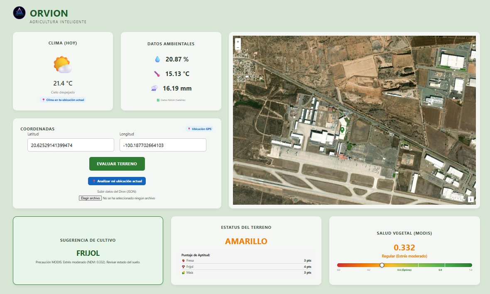

# 🌐 Orvion PWA (Frontend)



Aplicación web progresiva (PWA) construida con React y Vite. Diseñada con un enfoque *Mobile-First* para ser utilizada por agricultores directamente en el campo.

## 🚀 Ejecución en Desarrollo

1. Instala las dependencias:
   ```bash
   npm install
   ````
2. Configura la URL de la API en el archivo .env:
    ```env
    VITE_API_URL=http://localhost:8000
    ````
3. Inicia el servidor de Vite:
    ```bash
    npm run dev
    ````
## 📱 Probar la PWA y el Modo Offline

Para que los Service Workers y la opción de "Instalar App" funcionen, la aplicación debe ser compilada para producción:

1. Genera la build de producción:
npm run build

2. Levanta el servidor de previsualización:
    ```bash
    npm run preview
    ````
Abre http://localhost:4173. Verás el ícono de instalación en la barra de direcciones.

## 🗄️ Almacenamiento Local (IndexedDB)

La aplicación utiliza IndexedDB (a través de la librería idb) para garantizar que el agricultor no pierda información si se queda sin señal en el campo.

- nasa-cache: Guarda las respuestas de la API para evitar consultas repetitivas a los servidores de la NASA.

- drone-data: Almacena los archivos JSON de telemetría subidos por el usuario.

## 🗺️ Mapas y Geolocalización

- **Mapas:** Se utiliza **OpenLayers** con capas satelitales de alta resolución (Esri World Imagery) para que el agricultor pueda ver fotografías reales de su terreno, árboles y caminos.

- **Geolocalización:** El hook personalizado *useGeolocation* solicita permisos al navegador para centrar el mapa en la ubicación actual del usuario.

- **Clima en Tiempo Real:** A través de la API pública de **Open-Meteo**, se consulta la temperatura y el estado del cielo exacto de la ubicación actual.